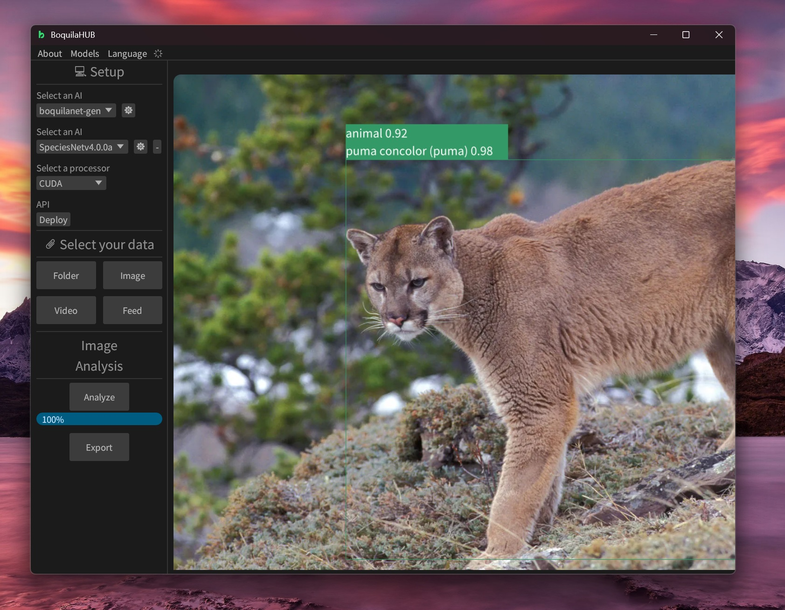

<div align="center">

<picture>
  
</picture>

Cross-platform app to run AI models to monitor and protect nature.

<h3>

[Features](#features) | [Installation](#installation)

</h3>

[](LICENSE)

</div>



## Features

- Cross-platform
- GUI, TUI and CLI tool
- Run AIs to process image, video, live feed or audio files
- Deploy and consume REST APIs, with maximum efficiency. Powered by [axum](https://github.com/tokio-rs/axum)
- Scalable, same binary works for IoT systems, simple GUI workflows or multiple GPU servers.

## Installation

Download the latest binaries from [releases](https://github.com/boquila/boquilahub/releases)

## AIs

Download supported models on [website](https://boquila.org/hub). You can also use or port your own, it's super easy.

## List of Platforms

| Platform                           |  Production ready  |
| --------------------------------- |------------ |
| Windows          | ✅ |
| Linux          | ✅ |
| MacOS          | ✅ |
| Android          | On the way |
| Web        | On the way |
| iOS          | Not soon |

## List of Runtimes

| Runtime           | Description                                                                        | Requirements  |
|-------------------|------------------------------------------------------------------------------------|--------------|
| CPU              | Your average CPU                                                                   | Having a CPU |
| NVIDIA CUDA      | NVIDIA GPUs supported by [ort's prebuilt CUDA runtime](https://github.com/pykeio/ort/blob/v2.0.0-rc.15/docs/content/perf/execution-providers.mdx#cuda) | CUDA 13.2+ + cuDNN 9.23+ on PATH |
| WebGPU | GPU acceleration via the WebGPU API, runs on most devices that support graphics | Having a modern GPU | 
| Remote BoquilaHUB | A BoquilaHUB session in your network with a deployed REST API                     | Having the URL | 

And soon more

## How to compile

```shell
git clone https://github.com/boquila/boquilahub/
cd boquilahub
```

**Windows / Linux**

On Windows, install Visual Studio 2026 Build Tools with the **Desktop development
with C++** workload and Windows SDK (tested with MSVC 14.51). The older Visual
Studio 2022 toolset cannot link the ONNX Runtime binaries used here.

```shell
cargo xtask fetch
cargo build --release
```

That's it, really simple.

`fetch` prepares FFmpeg; `cargo build` downloads and bundles the ONNX Runtime
selected by the pinned `ort` crate (1.31.0 for rc.15). CUDA builds use
`cargo build --no-default-features --features cuda` and require the NVIDIA
libraries listed above. The old `deps/onnxruntime` directory is no longer used.
Run `cargo clean` once when upgrading an existing checkout to remove old runtime
libraries from build outputs.

Native builds use FFmpeg 9: Windows downloads 9.0.2, Linux downloads the latest
9.0-branch shared build, and macOS shared builds require `brew install ffmpeg@9`.
The `ffmpeg-static` feature builds the `release/9.1` branch via `ffmpeg-sys-next`.
When upgrading an existing checkout, move the old `deps/ffmpeg` directory aside
before running `cargo xtask fetch` again, then run `cargo clean -p ffmpeg-sys-next`
to regenerate the native bindings.

Other options:

**macOS**

```shell
brew install pkg-config x264 nasm
chmod +x .github/macos-cc-shim.sh
export CARGO_TARGET_$(rustc -vV | sed -n 's/host: //p' | tr 'a-z-' 'A-Z_')_LINKER="$PWD/.github/macos-cc-shim.sh"
export PKG_CONFIG_PATH="$(brew --prefix x264)/lib/pkgconfig${PKG_CONFIG_PATH:+:$PKG_CONFIG_PATH}"
cargo build --release --features ffmpeg-static
```

**Linux (static FFmpeg)**

```shell
sudo apt install pkg-config yasm nasm libx264-dev
cargo build --release --features ffmpeg-static
```
